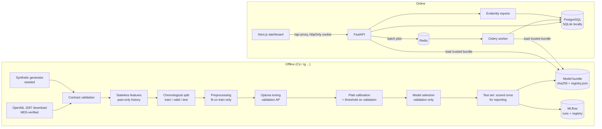

# TransactionGuard architecture

TransactionGuard produces **risk signals for analyst review**. It does not decide that a
transaction is fraud.

## Code layout

| Path | Responsibility |
|---|---|
| `src/transactionguard/core` | Settings (pydantic-settings, `TG_` env vars) and structured logging (structlog) |
| `src/transactionguard/data` | Data contract, validation, OpenML download, synthetic generator |
| `src/transactionguard/features` | Stateless past-only feature engineering and the fitted sklearn preprocessing |
| `src/transactionguard/training` | Splits, candidate models, Optuna, evaluation/thresholds/calibration, MLflow |
| `src/transactionguard/inference` | Model bundle + trusted registry, SHAP explanations, online scoring service |
| `src/transactionguard/monitoring` | Evidently data-quality / drift reports and operational metrics |
| `src/transactionguard/api` | FastAPI app, routers, Pydantic schemas, auth |
| `src/transactionguard/db` | SQLAlchemy 2.0 models and sessions (Alembic migrations in `migrations/`) |
| `src/transactionguard/worker` | Celery app and tasks (batch scoring, report generation) |
| `frontend/` | Next.js + TypeScript + Tailwind analyst dashboard |
| `tests/` | `unit` (no services), `integration` (API + DB, mocked broker), `e2e` (Playwright) |

## Leakage protections (in order of the training pipeline)

1. **Features are stateless and past-only.** A row's history features use strictly earlier
   transactions of the same account (`np.searchsorted` with `side="left"`), so computing them
   before splitting cannot leak the future. This is verified by tests that tamper with future rows.
2. **Chronological split.** Train ≤ t1 < validation ≤ t2 < test. Rows that share a timestamp
   are never split across a boundary.
3. **Fitted preprocessing on train only** (medians, scaling, one-hot vocabulary, variance filter).
4. **Validation-only decisions**: Optuna objective, Platt calibration, threshold, model selection.
5. **The test set is scored once, after all decisions.** A test shuffles the test labels and asserts
   that every decision is unchanged.

## Score semantics

| Model | Score | Meaning |
|---|---|---|
| Logistic Regression, XGBoost | `calibrated_probability` | Platt-calibrated estimate of P(source label = fraud) |
| Isolation Forest | `anomaly_score` | `2^(-E[path length]/c(n))`. Not a probability and not comparable in scale with the models above |
| Dummy | `constant_prior` | Training fraud rate (the "no skill" reference line) |
